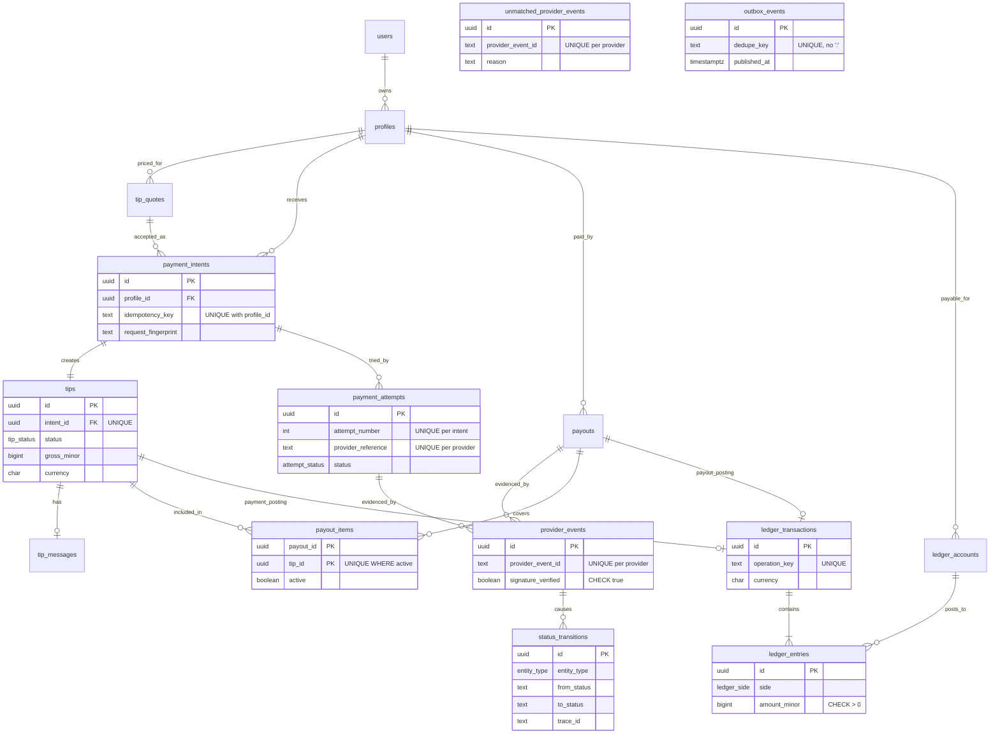

# Entity relationships (PR-005)

Source of truth: `packages/database/src/schema.ts` and `packages/database/drizzle/*.sql`. Money columns are `bigint` minor units with a `char(3)` ISO currency.

Rules the database enforces beyond keys: a quote funds one intent (`payment_intents.quote_id` UNIQUE); tip, attempt and payout status changes must follow the PRD state machines; ledger accounts are immutable; history tables refuse TRUNCATE; `status_transitions`, `ledger_transactions` and `ledger_entries` are append-only (triggers); every ledger transaction balances with at least two entries at commit (deferred constraint triggers); entry currency must match its transaction and account; quotes must satisfy `recipient_net = tip − platform fee − provider fee`.

`unmatched_provider_events` (PR-006) keeps verified provider messages that match no known attempt or payout; it is append-only and refuses TRUNCATE.
