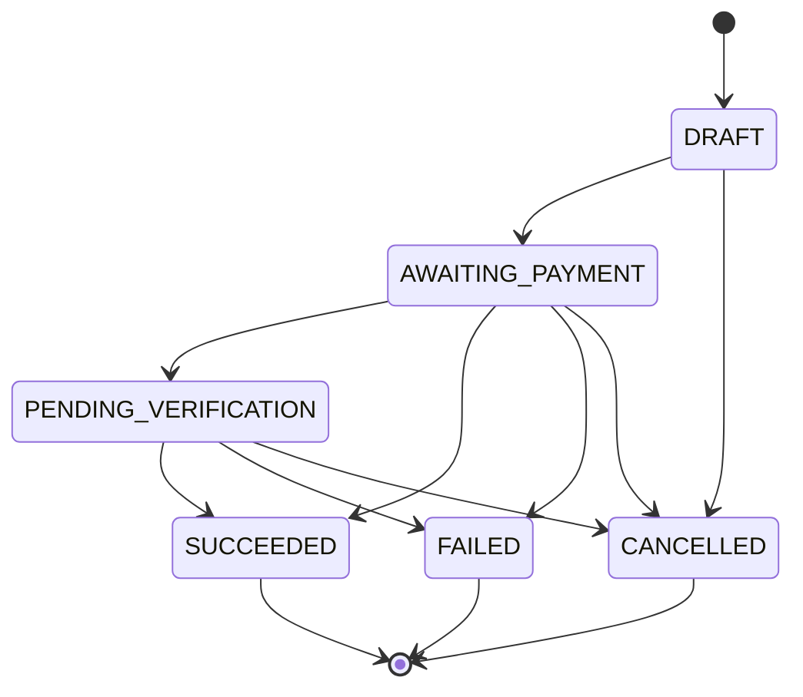
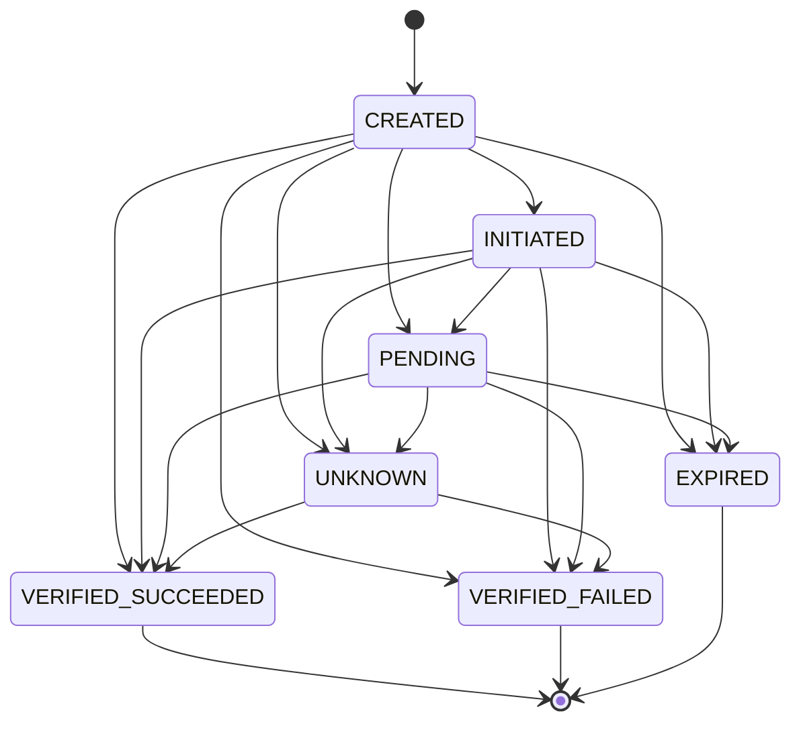
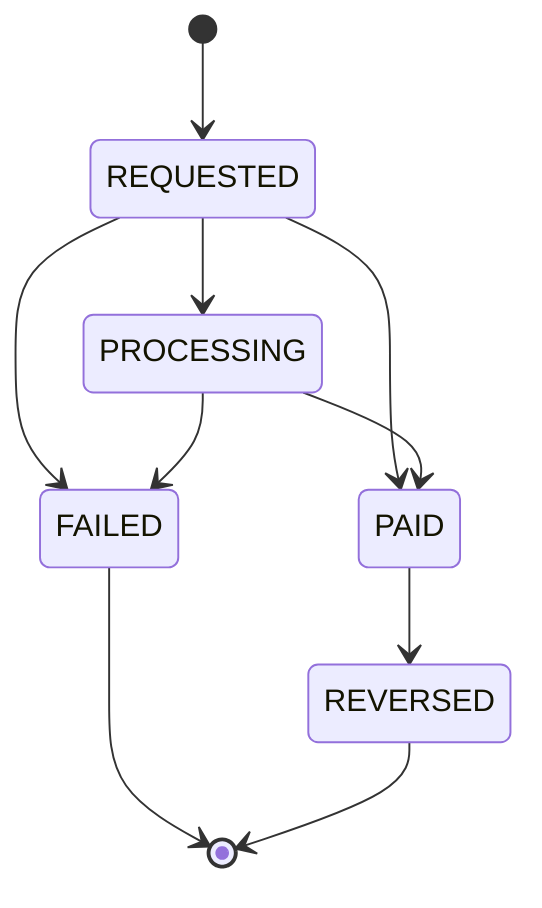

# Payment, attempt and payout state machines

PRD §15 (4). The states a tip, a payment attempt and a withdrawal can be in, what moves them, and what can never happen. The diagrams are **generated from the domain's own transition tables** (`packages/domain/src/state-machines.ts`); `scripts/generate-docs.test.mjs` fails when they drift. History is never rewritten: finished states have no way out.

Status: pretend money. Names follow the PRD (§6.3) and will be mapped onto the approved provider's names (D-03). Some states in the tables are **not used yet**; each is marked below.

## The rules that never bend

1. **Only a verified provider answer finishes a payment.** A redirect, a return address or a browser poll never marks a tip paid. The verdict comes from a signed webhook or a server-to-server status query, and is checked against the amount and currency TipMe quoted.
2. **A transition must be allowed.** Every change goes through `canTransition` under a row lock, in the same database transaction as its ledger postings and its outbox event. Two workers cannot both finish the same tip.
3. **A repeated or late event changes nothing.** A provider event is stored once, by its id; a second copy, or one that would move a finished attempt, is stored and ignored. Only a _success_ that arrives after a failure or expiry is flagged to staff.
4. **Money moves only with a balanced ledger entry.** The books balance per currency for every business operation; a wrong entry is reversed by a new one, never edited.
5. **A refund or dispute must be a separate record,** not a rewritten tip. Not built yet: it needs a real provider.

## Tip

What the supporter sees. Today a tip has exactly one payment attempt.

<!-- prettier-ignore-start -->
<!-- generated:tip -->

<!-- /generated:tip -->
<!-- prettier-ignore-end -->

| State                  | Meaning                                                                            | What moves it there                                                      |
| ---------------------- | ---------------------------------------------------------------------------------- | ------------------------------------------------------------------------ |
| `DRAFT`                | Not used today                                                                     | —                                                                        |
| `AWAITING_PAYMENT`     | The tip, its intent and attempt 1 exist; the provider is then asked for a checkout | Creating the intent (one transaction, before the provider is called)     |
| `PENDING_VERIFICATION` | The provider says the payment is in progress                                       | A verified `payment.pending` provider event only (never the status poll) |
| `SUCCEEDED`            | Verified paid. The recipient is credited exactly once                              | A verified success from a webhook or a reconciliation status check       |
| `FAILED`               | Verified failed or declined                                                        | A verified failure                                                       |
| `CANCELLED`            | The tip was never paid in time                                                     | The expiry job only (there is no supporter "cancel" action)              |

## Payment attempt

The provider's side of a tip, with its own reference (unique per provider).

<!-- prettier-ignore-start -->
<!-- generated:attempt -->

<!-- /generated:attempt -->
<!-- prettier-ignore-end -->

| State                | Meaning                                                                                                                                                                                  |
| -------------------- | ---------------------------------------------------------------------------------------------------------------------------------------------------------------------------------------- |
| `CREATED`            | Recorded before the provider is called. If starting the checkout fails or times out, it stays here with no provider reference until a retry or the expiry job's lookup finds the payment |
| `INITIATED`          | The provider returned a checkout and a reference                                                                                                                                         |
| `PENDING`            | The provider says it is in progress                                                                                                                                                      |
| `VERIFIED_SUCCEEDED` | Verified paid, with the amount and currency of the quote                                                                                                                                 |
| `VERIFIED_FAILED`    | Verified failed                                                                                                                                                                          |
| `EXPIRED`            | Closed by the expiry job                                                                                                                                                                 |
| `UNKNOWN`            | **Only** when the provider reports an amount or currency that does not match the quote. Nothing is booked, an issue opens, and only a verified verdict can move it on                    |

A provider event can arrive before TipMe has recorded `INITIATED`, so `CREATED` may jump straight to a verdict.

**How a missing answer is handled:**

- A payment the provider never reports stays `INITIATED` (or `PENDING`) until reconciliation asks the provider (`tests/integration/scenarios.test.mjs` scenario 7).
- A timeout while _starting_ checkout leaves the attempt `CREATED` with no reference: TipMe does not know whether the provider started it. Payments are started with TipMe's attempt id as the merchant reference, and starting is idempotent per attempt, so a retry returns the same payment, never a second one. Before the expiry job may cancel such a tip it looks the payment up by the attempt id; if the provider has it, its reference is recorded and its verified status decides (`packages/database/test/integration/expire.test.mjs`, threat model M11).
- `UNKNOWN` is kept for what the provider said but TipMe cannot accept (a wrong amount or currency); a missing answer is resolved by asking, as above.

## Withdrawal (payout)

A recipient asks to move money out. The amount is reserved from their available balance at once, under a lock on their page, so two requests cannot spend the same money.

<!-- prettier-ignore-start -->
<!-- generated:payout -->

<!-- /generated:payout -->
<!-- prettier-ignore-end -->

| State        | Meaning                                         | What moves it there                                                                  | Ledger effect                                         |
| ------------ | ----------------------------------------------- | ------------------------------------------------------------------------------------ | ----------------------------------------------------- |
| `REQUESTED`  | Reserved from the balance; sent to the provider | The recipient's request (it stays here after the provider accepts)                   | None yet; the amount is reserved                      |
| `PROCESSING` | The provider says it is in progress             | A verified `payout.processing` event                                                 | None yet                                              |
| `PAID`       | The provider confirmed it                       | A verified provider event or a reconciliation status check, never the first response | Moves the amount out of what TipMe owes the recipient |
| `FAILED`     | The provider confirmed it failed                | A verified failure                                                                   | The reservation is released                           |
| `REVERSED`   | Not used today                                  | —                                                                                    | —                                                     |

The minimum withdrawal is ₦1,000 (the whole balance may always be withdrawn). A success reported after `FAILED` opens a payout-conflict issue. A failure reported after `PAID` is stored and ignored, with no issue; payout reversals are not built (threat model, M12).

## Provider events: what happens to each

| Event                                                    | Result                                                              |
| -------------------------------------------------------- | ------------------------------------------------------------------- |
| Valid, new, allowed by the tables                        | Transition, ledger posting and outbox event in one transaction      |
| Valid, already seen (duplicate)                          | Stored once; nothing else changes                                   |
| A success after a failure or expiry                      | Recorded; opens a payment-conflict issue for staff                  |
| A failure after a success                                | Stored and ignored; the success stands; no issue                    |
| Wrong amount or currency                                 | Nothing is booked; the attempt becomes `UNKNOWN` and an issue opens |
| Unknown reference                                        | Stored and shown to staff as an unmatched event                     |
| Bad or missing signature, or outside the 5-minute window | Rejected before anything is stored                                  |
| Same event id, different contents                        | Opens a conflict issue; the first copy stays                        |

## Where it is tested

| Rule                                                             | Test                                                                                                                                         |
| ---------------------------------------------------------------- | -------------------------------------------------------------------------------------------------------------------------------------------- |
| Transition tables: reachable, finished states closed             | `scripts/generate-docs.test.mjs`, `packages/domain/test/state-machines.test.mjs`                                                             |
| Redirects and polls never mark a tip paid                        | `tests/e2e/checkout.spec.ts`, `packages/database/test/integration/tip-status.test.mjs`                                                       |
| Duplicate, out-of-order and forged events                        | `tests/integration/scenarios.test.mjs`, `tests/integration/webhooks.test.mjs`, `packages/database/test/integration/provider-events.test.mjs` |
| One intent, tip and attempt per idempotency key                  | `packages/database/test/integration/intents.test.mjs`, `tests/integration/checkout-api.test.mjs`                                             |
| A payment the provider never reported is found by reconciliation | `tests/integration/reconcile-flow.test.mjs`, `packages/database/test/integration/reconcile.test.mjs`                                         |
| Unpaid tips expire; a paid one is never cancelled                | `packages/database/test/integration/expire.test.mjs`                                                                                         |
| The books balance                                                | `packages/domain/test/ledger.test.mjs`, `packages/database/test/integration/invariants.test.mjs`                                             |
| Withdrawals reserve, settle, fail and release                    | `packages/database/test/integration/withdrawals.test.mjs`, `packages/database/test/integration/payouts.test.mjs`                             |
| A recipient is credited exactly once                             | `packages/database/test/integration/provider-events.test.mjs`, `packages/database/test/integration/reconcile.test.mjs`                       |

## Not built yet (needs a provider)

- Refunds, chargebacks and disputes: a separate record linked to the tip, with a reversing ledger entry.
- Payout reversals (`REVERSED`) and a failure reported after `PAID`.
- More than one attempt per tip.
- Settlement reports.

The approved provider's own statuses will be mapped onto these states in an ADR before any of this is added.
