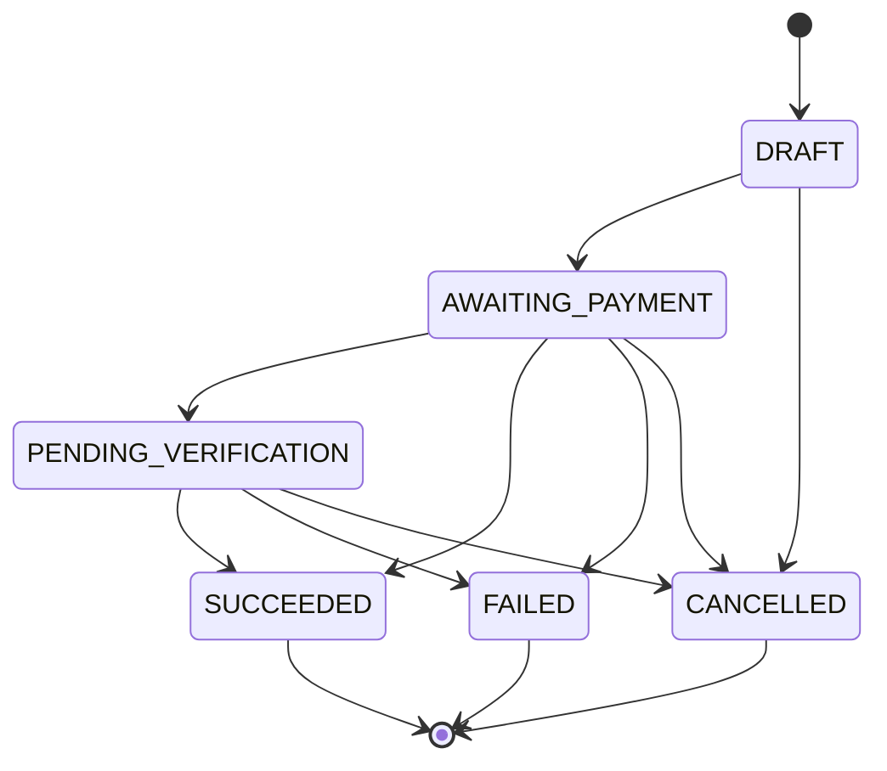
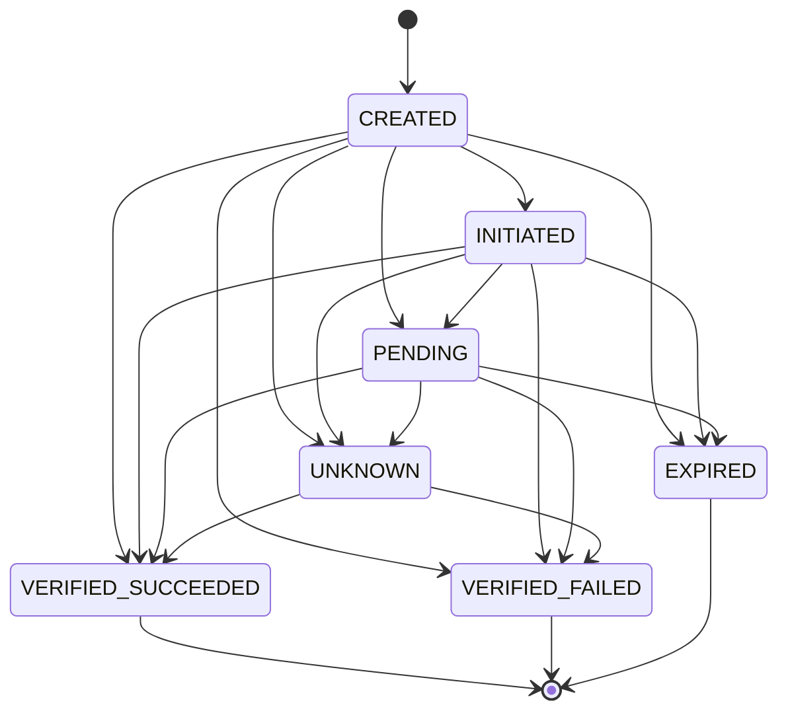
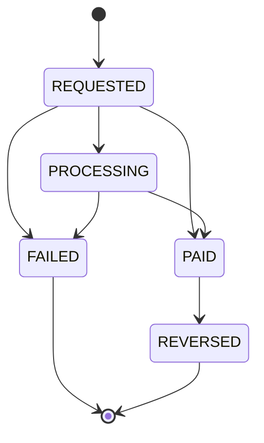

# Payment, attempt and payout state machines

PRD §15 (4). The states a tip, a payment attempt and a withdrawal can be in, who moves them, and what can never happen. The diagrams are **generated from the domain's own transition tables** (`packages/domain/src/state-machines.ts`), and `scripts/generate-docs.test.mjs` fails when they drift. History is never rewritten: finished states have no way out.

Status: pretend money. Names follow the PRD (§6.3) and will be mapped onto the approved provider's names (D-03).

## The rules that never bend

1. **Only a verified provider answer finishes a payment.** A redirect, a return URL or a browser poll can never mark a tip paid. The answer comes from a signed webhook or a server-to-server status query, and is checked against the amount and currency TipMe quoted.
2. **A transition must be allowed.** Every change goes through `canTransition` and a row lock, in the same database transaction as its ledger postings and its outbox event. Two workers cannot both finish the same tip.
3. **A repeated or late event changes nothing.** A provider event is stored once, by its id; a second copy, or one arriving after the tip is final, is recorded and ignored.
4. **An unclear answer is `UNKNOWN`, never a guess.** After a timeout the attempt waits, and only a verified answer moves it on. No second charge is made.
5. **Money moves only with a balanced ledger entry.** The books balance per currency for every business operation; a wrong entry is reversed by a new one, never edited.
6. **A refund or dispute is a separate record,** not a rewritten tip. (Not built yet: it needs a real provider.)

## Tip

What the supporter sees. A tip belongs to one payment intent; a new attempt can be made while it is still open.

<!-- prettier-ignore-start -->
<!-- generated:tip -->

<!-- /generated:tip -->
<!-- prettier-ignore-end -->

| State                  | Meaning                                                                   | Moved by                            |
| ---------------------- | ------------------------------------------------------------------------- | ----------------------------------- |
| `DRAFT`                | Created from a quote, no payment started                                  | The supporter starting checkout     |
| `AWAITING_PAYMENT`     | The provider has been asked for a checkout                                | TipMe, after the provider accepts   |
| `PENDING_VERIFICATION` | The supporter says they paid; TipMe is waiting for the provider           | The status poll or a provider event |
| `SUCCEEDED`            | The provider verified the payment. The recipient is credited exactly once | A verified provider answer only     |
| `FAILED`               | The provider verified that it failed or was declined                      | A verified provider answer          |
| `CANCELLED`            | The supporter left, or the quote or checkout expired                      | The supporter, or the expiry job    |

## Payment attempt

The provider's side of a tip, with its own reference. A tip can have several attempts (each unique per provider reference).

<!-- prettier-ignore-start -->
<!-- generated:attempt -->

<!-- /generated:attempt -->
<!-- prettier-ignore-end -->

| State                | Meaning                                                                            |
| -------------------- | ---------------------------------------------------------------------------------- |
| `CREATED`            | Recorded before the provider is called                                             |
| `INITIATED`          | The provider returned a checkout                                                   |
| `PENDING`            | The provider says it is in progress                                                |
| `VERIFIED_SUCCEEDED` | Verified paid (the amount and currency match the quote)                            |
| `VERIFIED_FAILED`    | Verified failed                                                                    |
| `EXPIRED`            | The window passed without an answer                                                |
| `UNKNOWN`            | A timeout or an answer TipMe cannot trust; **resolves only to a verified verdict** |

A provider event can arrive before TipMe has recorded `INITIATED`, so `CREATED` may jump straight to a verdict.

## Withdrawal (payout)

A recipient asks to move money out. The amount is reserved from their available balance at once, so two requests cannot spend the same money.

<!-- prettier-ignore-start -->
<!-- generated:payout -->

<!-- /generated:payout -->
<!-- prettier-ignore-end -->

| State        | Meaning                                                       | Ledger effect                                        |
| ------------ | ------------------------------------------------------------- | ---------------------------------------------------- |
| `REQUESTED`  | Reserved from the balance, sent to the provider               | None yet                                             |
| `PROCESSING` | The provider accepted it                                      | None yet                                             |
| `PAID`       | The provider confirmed (reconciliation, not the first answer) | Moves the recipient's balance out of what TipMe owes |
| `FAILED`     | The provider confirmed it failed                              | The reservation is released                          |
| `REVERSED`   | A paid withdrawal that came back                              | A reversing entry; investigated in the issues inbox  |

The minimum withdrawal is ₦1,000 (the whole balance may always be withdrawn). A `PAID` payout the provider later reports as failed becomes an issue for staff; nothing is edited.

## Provider events: what happens to each

| Event                                                        | Result                                                               |
| ------------------------------------------------------------ | -------------------------------------------------------------------- |
| Valid, new, in order                                         | Transition, ledger posting and outbox event in one transaction       |
| Valid, already seen (duplicate)                              | Stored once; nothing else changes                                    |
| Valid, arrives after the tip is final (late or out of order) | Never downgrades; a success after a failure opens an issue for staff |
| Wrong amount or currency                                     | Nothing is booked; the payment is held as unknown and an issue opens |
| Unknown reference                                            | Stored and shown to staff as an unmatched event                      |
| Bad or missing signature, or outside the 5-minute window     | Rejected before anything is stored                                   |
| Same event id, different contents                            | Opens a conflict issue; the first copy stays                         |

## Where it is tested

| Rule                                                 | Test                                                                                                             |
| ---------------------------------------------------- | ---------------------------------------------------------------------------------------------------------------- |
| Transition tables: reachable, finished states closed | `scripts/generate-docs.test.mjs`, `packages/domain/test/state-machines.test.mjs`                                 |
| Redirects and polls never mark a tip paid            | `tests/integration/checkout-api.test.mjs`, `tests/integration/scenarios.test.mjs`                                |
| Duplicate, out-of-order and forged events            | `tests/integration/webhooks.test.mjs`, `packages/database/test/integration/provider-events.test.mjs`             |
| One logical intent per idempotency key               | `tests/integration/checkout-api.test.mjs`, `packages/database/test/integration/intents.test.mjs`                 |
| Timeouts end as `UNKNOWN` and reconcile              | `tests/integration/reconcile-flow.test.mjs`, `packages/database/test/integration/reconcile.test.mjs`             |
| The books balance; reversals link back               | `packages/domain/test/ledger.test.mjs`, `packages/database/test/integration/provider-events.test.mjs`            |
| Withdrawals reserve, settle, fail and release        | `packages/database/test/integration/withdrawals.test.mjs`, `packages/database/test/integration/payouts.test.mjs` |
| A recipient is credited exactly once                 | `packages/database/test/integration/provider-events.test.mjs`                                                    |

## Not built yet (needs a provider)

Refunds, chargebacks and disputes (a separate `Refund/Dispute` record linked to the tip and a reversing ledger entry), settlement reports, and payout holds. The approved provider's own statuses will be mapped onto these states in an ADR before any of them is added.
