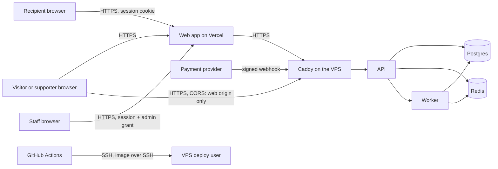

# Threat model and security checklist

PRD §15 (8) and §14 "Security: threat-model closure for critical risks". What could go wrong, what stops it today, the proof, and what is still open. Written for engineers and for the independent review that `docs/05-SECURITY.md` requires before real funds.

Status: money is pretend. This document does not approve real payments; "Open" items marked **blocks real money** must be closed or explicitly accepted by the product owner first (`docs/00-DECISIONS.md`, D-03 to D-08, D-11).

## What is protected

| Asset                                                                                        | Why it matters                                                        |
| -------------------------------------------------------------------------------------------- | --------------------------------------------------------------------- |
| **Money records** (ledger, tips, withdrawals)                                                | Wrong or double entries are real losses; history must never be edited |
| **Recipients' personal details** (phone, email, photo, bio, socials)                         | Privacy, and the key to taking over an account                        |
| **Supporters' messages**                                                                     | Private, sometimes abusive; supporters give no identity               |
| **Sessions and admin grants**                                                                | Whoever holds one acts as that person                                 |
| **Secrets** (provider keys, `BACKUP_KEY`, `OPS_TOTP_KEY`, signing secrets, preview password) | One leak can break several controls                                   |
| **Availability** of the tipping page and checkout                                            | A tip lost at a counter is lost for good                              |
| **Trust in a recipient's identity**                                                          | A fake page or a swapped QR code diverts real tips                    |

## Trust boundaries

The browser, the provider and GitHub are outside TipMe's control. Postgres, Redis and the worker are reachable only from inside the private network; on the server only Caddy publishes ports (80 and 443). The worker has **no route to the internet** today: with the pretend provider, reconciliation's status queries stay inside the app. A real provider will need an outbound route for the worker, limited to the provider's hosts.

## Threats

"Evidence" names the code or test that shows the control works. **Status:** _Mitigated_ (built and tested), _Partly_ (built, with a stated gap), _Open_ (not built; needs a decision or a provider).

### Money and payments

| #   | Threat                                                                                               | What stops it                                                                                                                                                                                                                                                                                                                                                                       | Evidence                                                                                                                                           | Status                                                                                                                                            |
| --- | ---------------------------------------------------------------------------------------------------- | ----------------------------------------------------------------------------------------------------------------------------------------------------------------------------------------------------------------------------------------------------------------------------------------------------------------------------------------------------------------------------------- | -------------------------------------------------------------------------------------------------------------------------------------------------- | ------------------------------------------------------------------------------------------------------------------------------------------------- |
| M1  | **A forged "payment succeeded"** (fake webhook, or a crafted return URL marks a tip paid)            | Webhooks are verified against a signature over the raw body, with a 5-minute window, before anything is stored. A return URL or poll never authorises payment; only a verified provider answer does. Request bodies are limited in size, and a client that is slow to _send_ its request is cut off after 10 seconds (this does not limit how long a handler runs)                  | `packages/payments/src/signing.ts`, `tests/integration/webhooks.test.mjs`, `tests/integration/checkout-api.test.mjs`, `tests/e2e/checkout.spec.ts` | Mitigated for the mock. **Blocks real money:** the real provider's signature scheme must be implemented and these tests rerun against its sandbox |
| M2  | **Replayed or duplicated events** credit twice                                                       | Provider events are stored once by id; every posting has a unique operation key; transitions are guarded by row locks                                                                                                                                                                                                                                                               | `packages/database/test/integration/provider-events.test.mjs`, `tests/integration/webhooks.test.mjs`                                               | Mitigated                                                                                                                                         |
| M3  | **Out-of-order events** downgrade a success                                                          | A final state has no exits. A late failure after a success is stored and ignored (the success stands, no issue). A late success after a failure or expiry is recorded and opens a conflict issue for staff                                                                                                                                                                          | `docs/architecture/state-machines.md`, `packages/database/test/integration/provider-events.test.mjs`                                               | Mitigated                                                                                                                                         |
| M4  | **Amount or currency tampering** (a client changes the amount; the provider reports a different one) | The server prices every tip and stores the quote; the provider's amount and currency are compared with the quote, and a mismatch books nothing and opens an issue                                                                                                                                                                                                                   | `packages/database/test/integration/quotes.test.mjs`, `packages/database/test/integration/provider-events.test.mjs`                                | Mitigated                                                                                                                                         |
| M5  | **Double-spending a balance** (two withdrawals at once)                                              | The page row is locked, the amount is reserved at once, withdrawals need an idempotency key                                                                                                                                                                                                                                                                                         | `packages/database/test/integration/withdrawals.test.mjs`, `tests/integration/dashboard-api.test.mjs`                                              | Mitigated                                                                                                                                         |
| M6  | **Books that do not balance, or edited history**                                                     | Postings must balance per currency before they are written; ledger tables refuse updates and deletes                                                                                                                                                                                                                                                                                | `packages/domain/test/ledger.test.mjs`, `packages/database/test/integration/invariants.test.mjs`                                                   | Mitigated                                                                                                                                         |
| M7  | **A mismatch with the provider goes unnoticed**                                                      | Scheduled reconciliation asks the provider for the status of open payments and withdrawals; conflicts become issues for staff                                                                                                                                                                                                                                                       | `tests/integration/reconcile-flow.test.mjs`, `packages/database/test/integration/reconcile.test.mjs`                                               | Mitigated. Settlement reports are open (needs a provider)                                                                                         |
| M8  | **Reward abuse** (fee-free tips beyond what TipMe can afford)                                        | Credits are reserved per quote; a lifetime cap and a monthly budget limit the cost                                                                                                                                                                                                                                                                                                  | `packages/database/test/integration/moments.test.mjs`                                                                                              | Mitigated                                                                                                                                         |
| M9  | **Chargebacks, refunds and disputes**                                                                | Not modelled                                                                                                                                                                                                                                                                                                                                                                        | `docs/architecture/state-machines.md`                                                                                                              | **Open — blocks real money** (needs a provider and the two-person rule)                                                                           |
| M10 | **Withdrawal to the wrong or a stolen destination**                                                  | Withdrawals go to a pretend bank only; no destination is stored                                                                                                                                                                                                                                                                                                                     | `docs/architecture/state-machines.md` (withdrawal section)                                                                                         | **Open — blocks real money:** payout accounts, verification and holds depend on D-06                                                              |
| M11 | **A timeout after the provider may have captured money**                                             | Every payment is started with TipMe's attempt id as the merchant reference, and starting is idempotent per attempt: a retry after a timeout returns the same payment, never a second one. An attempt left with no provider reference is looked up by that id before the expiry job may cancel it; if the provider has it, its reference is recorded and its verified status decides | `packages/database/test/integration/expire.test.mjs`, `packages/payments/test/integration/mock-provider.test.mjs`                                  | Mitigated for the mock. **Blocks real money:** the real adapter must keep both promises (rerun these tests against its sandbox)                   |
| M12 | **A paid withdrawal is reversed or later reported failed**                                           | `REVERSED` exists in the state table but nothing sets it; a failure reported after `PAID` is stored and ignored with no issue                                                                                                                                                                                                                                                       | `docs/architecture/state-machines.md`                                                                                                              | **Open — blocks real money:** reversals need a provider, a ledger entry and an issue for staff                                                    |

### Identity and access

| #   | Threat                                                                 | What stops it                                                                                                                                                                                                                                                                                                                   | Evidence                                                                                                                            | Status                                                                                                                                                         |
| --- | ---------------------------------------------------------------------- | ------------------------------------------------------------------------------------------------------------------------------------------------------------------------------------------------------------------------------------------------------------------------------------------------------------------------------- | ----------------------------------------------------------------------------------------------------------------------------------- | -------------------------------------------------------------------------------------------------------------------------------------------------------------- |
| A1  | **Guessing a sign-in code**                                            | 6-digit codes expire in 10 minutes; five wrong codes lock the number for 15 minutes; sign-in routes are rate-limited per address and per number                                                                                                                                                                                 | `packages/database/test/integration/sign-in.test.mjs`, `tests/integration/auth-api.test.mjs`                                        | Mitigated. SMS cost abuse and SIM swap depend on the messaging provider (D-11). The lockout can be used to keep someone out for 15 minutes at a time (see A10) |
| A2  | **Stealing a session**                                                 | Cookie is HttpOnly, SameSite=Lax and Secure; a session ends 30 days after sign-in however often it is used (the same life as the cookie); sessions are listed and can be revoked one by one or all but this one                                                                                                                 | `apps/api/src/auth/cookies.ts`, `packages/database/test/integration/sessions.test.mjs`                                              | Partly: a script injected into the page could act as the user (see X1)                                                                                         |
| A3  | **Cross-site request forgery**                                         | State-changing requests need the web app's exact Origin and a custom header; cookies are SameSite=Lax                                                                                                                                                                                                                           | `apps/api/src/auth/csrf.guard.ts`, `scripts/generate-docs.test.mjs` (every route), `tests/integration/ops-access.test.mjs`          | Mitigated                                                                                                                                                      |
| A4  | **Account takeover by recovery**                                       | Moving a number by email takes 24 hours, is confirmed by a code to the new number, warns the old number and the email, can be cancelled by the owner or by staff, and removes admin access until re-granted                                                                                                                     | `tests/integration/notifications-api.test.mjs`, `packages/database/test/integration/notifications.test.mjs`                         | Mitigated                                                                                                                                                      |
| A5  | **Reading or changing another recipient's data**                       | Every `/v1/me/*` route finds the page from the session; others' tips and messages answer "not found"                                                                                                                                                                                                                            | `tests/integration/profiles-api.test.mjs`, `tests/integration/dashboard-api.test.mjs`, `tests/integration/message-reports.test.mjs` | Mitigated                                                                                                                                                      |
| A6  | **A staff account is taken over, or staff overreach**                  | Staff need an authenticator code for a grant (12 hours, 1 hour idle); five wrong codes lock admin access; the area answers 404 to everyone else; roles are least-privilege; every action and reveal is audited; staff are created only on the server                                                                            | `docs/security/access-control.md`, `tests/integration/ops-access.test.mjs`, `packages/database/test/integration/staff.test.mjs`     | Partly: one authenticator per person; a hardware key and the two-person rule for money come with real money                                                    |
| A7  | **A fake page impersonates someone**                                   | Anyone can report a page; one issue per page for staff; pages can be paused with a reason; reserved handles; a deleted or renamed page's handle is held for 90 days and then becomes claimable                                                                                                                                  | `tests/integration/profile-reports.test.mjs`, `tests/integration/handle-renames.test.mjs`                                           | Partly: no verified badge until recipient verification is decided (D-06); after 90 days an old handle can be taken by someone else                             |
| A8  | **A printed QR code is swapped or leads to a stranger**                | The code holds only TipMe's own HTTPS address; a renamed page keeps working through an alias that nobody else can claim for 90 days                                                                                                                                                                                             | `tests/integration/handle-renames.test.mjs`, `apps/web/test/qr-styles.test.mjs`                                                     | Partly: after 90 days an old printed code can lead to a stranger who claimed the handle. A physically replaced sticker cannot be prevented                     |
| A9  | **A hidden admin route is found**                                      | Every admin refusal for non-staff is 404, the routes need the permission, and a test lists every route's guard                                                                                                                                                                                                                  | `tests/integration/ops-access.test.mjs`, `scripts/generate-docs.test.mjs`                                                           | Mitigated                                                                                                                                                      |
| A10 | **Locking someone out on purpose** (five wrong codes for their number) | The lock lasts 15 minutes; sign-in is rate-limited per address and per number                                                                                                                                                                                                                                                   | `packages/database/test/integration/sign-in.test.mjs`                                                                               | Accepted for now. Watch for repeated lockouts when production monitoring is chosen                                                                             |
| A11 | **The release check's staff account is misused**                       | The release check signs in as a staff member with the `release_check` role, using an authenticator secret and a token held only in the GitHub `staging` environment; the role can view and resolve issues and view analytics and the audit log, nothing else; the token route works only on copies that say `RELEASE_KIND=test` | `docs/security/access-control.md`, `packages/database/test/integration/staff.test.mjs`                                              | Partly: whoever holds those CI secrets can act as that staff member on staging                                                                                 |

### Privacy and content

| #   | Threat                                                                                                          | What stops it                                                                                                                                                                                                                               | Evidence                                                                                                                                                                               | Status                                                                                        |
| --- | --------------------------------------------------------------------------------------------------------------- | ------------------------------------------------------------------------------------------------------------------------------------------------------------------------------------------------------------------------------------------- | -------------------------------------------------------------------------------------------------------------------------------------------------------------------------------------- | --------------------------------------------------------------------------------------------- |
| P1  | **Personal data in logs, traces or error reports**                                                              | Log fields are redacted by key and the request, response, body, headers and query are never logged; error reports carry only the error type, a safe code, stack frames inside TipMe's code, the route pattern and a trace id                | `packages/observability/src/logger.ts`, `packages/observability/test/logger.test.mjs`, `packages/observability/test/error-reporter.test.mjs`, `apps/api/test/error-reporting.test.mjs` | Mitigated                                                                                     |
| P2  | **A supporter's message leaks**                                                                                 | Messages are never in outbox events or logs; staff see them only by revealing with a reason (audited); recipients can hide or report them                                                                                                   | `packages/database/test/integration/provider-events.test.mjs`, `tests/integration/message-reports.test.mjs`, `tests/integration/ops-issues.test.mjs`                                   | Mitigated                                                                                     |
| P3  | **A hostile image upload** (script in an SVG, a disguised file, a decompression bomb, location in the metadata) | The server decodes and re-encodes every upload to a 512×512 WebP; only JPEG, PNG and WebP are accepted; 5 MB, 25 megapixels, 5 seconds, rate-limited; photos are served `nosniff` with a locked-down content policy and only for live pages | `tests/integration/avatars.test.mjs`, `tests/integration/avatars-limit.test.mjs`                                                                                                       | Mitigated                                                                                     |
| P4  | **Search or report endpoints used to learn private data**                                                       | Reports always answer the same; recipients and staff match a payment reference only by its visible ending; admin results carry ids and labels only; searches are audited by length                                                          | `tests/integration/profile-reports.test.mjs`, `tests/integration/tip-search.test.mjs`, `tests/integration/ops-search.test.mjs`                                                         | Mitigated                                                                                     |
| P5  | **Tracking people without consent**                                                                             | Analytics are anonymous, cookieless, honour Global Privacy Control and Do Not Track, and are off in production until D-07                                                                                                                   | `tests/integration/analytics.test.mjs`, `apps/web/test/analytics-client.test.mjs`                                                                                                      | Mitigated                                                                                     |
| P6  | **Personal data kept too long**                                                                                 | Deleting an account erases the profile, photo and contact details, keeps money records by id only, and holds the handle for 90 days; raw analytics are purged after 90 days and page reports after 180                                      | `packages/database/test/integration/profiles.test.mjs`, `tests/integration/avatars.test.mjs`                                                                                           | Partly: a written retention schedule and legal basis need D-07                                |
| P7  | **Script injection through user content** (display name, bio, message)                                          | Content is rendered as text by React (the app uses no raw HTML injection); links are limited to https addresses on the named social sites; return addresses go through a safe-redirect check                                                | `apps/web/test/safe-next.test.mjs`, `packages/contracts/src/profiles.ts`                                                                                                               | Mitigated. See X1 for the missing content policy                                              |
| P8  | **The pretend inbox shows every sign-in code**                                                                  | Only copies with pretend messaging have it, and it is refused in production. On a preview copy (staging) it needs the release token as well as the preview password; anyone else gets 404                                                   | `apps/api/src/dev/pretend-inbox.controller.ts`, `tests/integration/preview-gate.test.mjs`                                                                                              | Mitigated. Gone with real messaging; whoever holds the release token can read staging's codes |
| P9  | **A receipt link is shared or leaked**                                                                          | A receipt needs the tip's own status token, which is random and unguessable                                                                                                                                                                 | `tests/integration/checkout-api.test.mjs`                                                                                                                                              | Partly: the token never expires, so a leaked receipt link stays readable                      |

### Platform and operations

| #   | Threat                                                     | What stops it                                                                                                                                                                                                                                                                | Evidence                                                                                                                    | Status                                                                                                                                                                                                                              |
| --- | ---------------------------------------------------------- | ---------------------------------------------------------------------------------------------------------------------------------------------------------------------------------------------------------------------------------------------------------------------------- | --------------------------------------------------------------------------------------------------------------------------- | ----------------------------------------------------------------------------------------------------------------------------------------------------------------------------------------------------------------------------------- |
| X1  | **Cross-site scripting not contained by a content policy** | Pages send `frame-ancestors 'none'`, `object-src 'none'`, `nosniff`, a strict referrer policy and a permissions policy; a script and style policy needs per-request nonces and is deferred                                                                                   | `apps/web/next.config.ts`                                                                                                   | Partly. **Decide before real money** whether to add nonce-based script rules                                                                                                                                                        |
| X2  | **A leaked secret**                                        | A scan of the whole Git history runs in CI (redacted); real `.env` files are never committed; the server file is mode 600; secrets for staging and production are separate                                                                                                   | `.github/workflows/ci.yml`, `.gitleaks.toml`, `docs/runbooks/staging-setup.md`                                              | Mitigated. Staging has its own secrets and production will have separate ones. A rotation checklist per secret is open                                                                                                              |
| X3  | **A vulnerable dependency**                                | `pnpm audit --prod` fails the build on a high or critical advisory; versions are pinned exactly; the lockfile is frozen in CI                                                                                                                                                | `.github/workflows/ci.yml`, `pnpm-workspace.yaml`                                                                           | Partly: development tools are not audited, and a new advisory is found only at the next push                                                                                                                                        |
| X4  | **Flooding the public routes**                             | Per-address rate limits; JSON bodies limited to 16 KB; requests time out after 10 seconds; image uploads are capped                                                                                                                                                          | `apps/api/src/checkout/rate-limit.guard.ts`, `apps/api/test/limits.test.mjs`, `tests/integration/resilience.test.mjs`       | Partly: no network-level protection (CDN or WAF) in front of the VPS; volumetric attacks are not stopped. **Decide with D-08 before launch**                                                                                        |
| X5  | **The rate limiter itself fails**                          | If Redis errors the limiter lets requests through and logs it (availability over throttling); the 15-minute watcher reports an API that is not ready                                                                                                                         | `apps/api/src/checkout/rate-limit.guard.ts`, `scripts/watch-staging.mjs`                                                    | Accepted. Alert on Redis failure when production monitoring is chosen                                                                                                                                                               |
| X6  | **The server is broken into**                              | The app containers (API, worker, migrations) run as the non-root `node` user; only Caddy publishes ports; Postgres and Redis are on a private network; SSH is key-only for a deploy user, with a firewall and fail2ban; the image is built in CI and the server never builds | `deploy/Dockerfile`, `deploy/compose.staging.yml`, `docs/runbooks/staging-setup.md`                                         | Partly: a single VPS; no intrusion detection; Caddy runs as root inside its container; Redis has no password (it relies on the private network); the deploy user is in the `docker` group, which is effectively root on that server |
| X7  | **Data is lost or corrupted**                              | Encrypted daily backups, WAL archiving (about 5 minutes of possible loss), a restore drill and a point-in-time recovery drill, and an optional off-server copy                                                                                                               | `docs/runbooks/backup-and-restore.md`, `deploy/scripts/pitr-drill.sh`, `packages/database/test/integration/backup.test.mjs` | Mitigated. **Switch on the off-server copy before real money**                                                                                                                                                                      |
| X8  | **A bad release**                                          | A release check proves the tip-to-admin journey; deploys back up first, migrate with a guard, and roll back on their own if the new version is unhealthy; migrations only add                                                                                                | `docs/runbooks/deploy-and-rollback.md`, `scripts/deploy-scripts.test.mjs`                                                   | Mitigated                                                                                                                                                                                                                           |
| X9  | **A compromised CI or deploy key**                         | The deploy key and secrets live in a GitHub environment; the key is deleted from the runner after use; the server's identity is pinned                                                                                                                                       | `.github/workflows/deploy-staging.yml`                                                                                      | Partly: third-party Actions are pinned by version tag, not by commit, and run in the same job as the deploy secrets, so a compromised Action could read them                                                                        |
| X10 | **Staging mistaken for production, or indexed**            | A shared password gate on both hosts, `noindex` everywhere, `robots.txt` disallowing all, the release kind and `paymentsLive` shown on `/health/release`                                                                                                                     | `tests/integration/preview-gate.test.mjs`, `apps/web/test/seo.test.mjs`                                                     | Mitigated                                                                                                                                                                                                                           |

## The PRD's P0 security controls (`docs/05-SECURITY.md`)

| Control                                                                                                                             | Status                                                                                                                                                                                                                                            | Where                                                                    |
| ----------------------------------------------------------------------------------------------------------------------------------- | ------------------------------------------------------------------------------------------------------------------------------------------------------------------------------------------------------------------------------------------------- | ------------------------------------------------------------------------ |
| Separate public, recipient and internal authorization, enforced on the server                                                       | Done                                                                                                                                                                                                                                              | `docs/security/access-control.md`                                        |
| Sessions: Secure, HttpOnly, SameSite; rotate on sign-in; revoke; CSRF protection                                                    | Done                                                                                                                                                                                                                                              | A2, A3                                                                   |
| Validate input lengths, ids, currencies and amounts; parameterised queries                                                          | Done                                                                                                                                                                                                                                              | zod schemas on every body and query; all SQL values are bound parameters |
| Strong rate limiting for auth, quotes, tips, webhooks and lookups                                                                   | Partly: sign-in, quotes, tips, reports, events and uploads are limited; webhooks, receipt lookups, public page and photo reads, and the pretend-only routes are not. See X4 and X5                                                                | `apps/api/src/checkout/rate-limit.guard.ts`                              |
| Signed webhook verification on the raw body, replay rules documented                                                                | Done for the mock; redo with the real provider                                                                                                                                                                                                    | M1                                                                       |
| Least-privilege database and infrastructure; separate credentials per environment                                                   | Partly: on staging the API and worker use a runtime role that can only read and write rows; migrations use their own role, backups a read-only role, and only one-off restores use the owner (ADR-0013). Production roles need their own approval | X6                                                                       |
| Image uploads: type sniffing, size limits, transformation, delivery boundaries                                                      | Done                                                                                                                                                                                                                                              | P3                                                                       |
| Encryption in transit and at rest; minimise personal data; retention and deletion                                                   | Partly: HTTPS everywhere and encrypted backups; the retention schedule needs D-07                                                                                                                                                                 | P6, X7                                                                   |
| Strong staff authentication, audit logs, controlled support access, two-person approval for money                                   | Partly: no money actions exist in the admin, so the two-person rule is not yet needed or built                                                                                                                                                    | A6                                                                       |
| No card numbers or CVV handled                                                                                                      | Done: checkout is the provider's hosted page; logs redact card fields                                                                                                                                                                             | P1                                                                       |
| Impersonation reporting; message moderation; fraud controls on volume                                                               | Partly: reporting and moderation are done; velocity and risk controls depend on the provider and D-06/D-07                                                                                                                                        | A7, P2                                                                   |
| SAST, dependency analysis and secret scanning in CI                                                                                 | Partly: dependency and secret scans are done; static analysis (for example CodeQL) is not yet in CI                                                                                                                                               | X2, X3                                                                   |
| Authorization tests across roles; webhook forgery and replay; payment concurrency; cache-leak tests; CSP and headers; log redaction | Done except cache-leak tests and a full content policy                                                                                                                                                                                            | `docs/quality/test-plan.md`                                              |
| Independent review before real funds                                                                                                | **Open — blocks real money**                                                                                                                                                                                                                      | —                                                                        |

## What must be closed before real money moves

1. **M1** the real provider's webhook signature scheme, tested against its sandbox.
2. **M9** refunds, chargebacks and disputes, with the two-person rule for manual money actions.
3. **M10** payout destinations: verification, limits and holds (D-06).
4. **X1** a decision on a nonce-based content policy.
5. **X4** protection in front of the API against floods, chosen with the hosting budget (D-08).
6. **X7** the off-server backup copy switched on and its restore drilled.
7. **P6** a written retention schedule with its legal basis (D-07).
8. **M12** payout reversals.
9. **M11** with the real provider: its adapter must start payments with TipMe's attempt id as the merchant reference and look them up by it.
10. The database-role split (ADR-0013) carried to production; static analysis in CI; a secret rotation checklist; third-party Actions pinned by commit.
11. The independent security review of this document and the code.

## How this stays true

- The access matrix and state diagrams are generated from the code, and a test fails when they drift.
- A new public route fails `scripts/generate-docs.test.mjs` until it is reviewed and explained.
- Every pull request that changes persistence, an endpoint or a provider adapter updates the matching row here, per `docs/06-QUALITY-GATES.md`.
